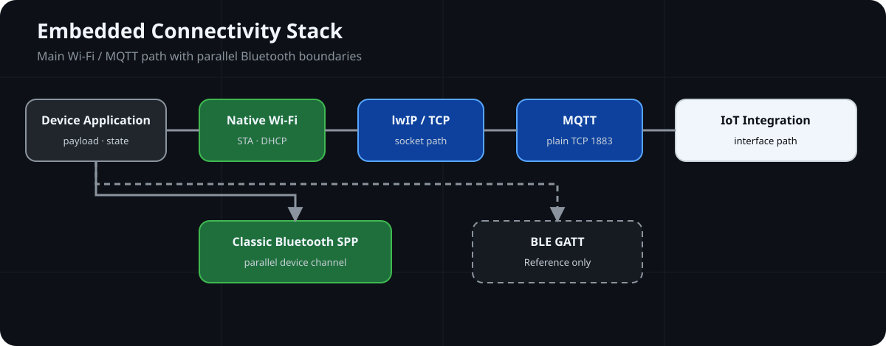

# Wireless IoT Embedded Lab

A real **Host MQTT telemetry and remote-control application** using an original portable C11 device model, official libmosquitto, a loopback-only Mosquitto Broker, and independent MQTT test clients. The device values are synthetic. No JieLi firmware, Wi-Fi, lwIP, Aliyun or TLS runtime is claimed.



## Host build and verification

Ubuntu 24.04 is the CI platform. Install CMake 3.20+, Ninja, GCC/Clang, Python 3, `pkg-config`, `mosquitto`, `mosquitto-clients` and `libmosquitto-dev` from the distribution, then run:

```sh
cmake -S . -B build -G Ninja -DCMAKE_BUILD_TYPE=Debug
cmake --build build --parallel
ctest --test-dir build --output-on-failure
```

The tests launch an actual Broker on `127.0.0.1` with a temporary listener, and separate `mosquitto_sub` / `mosquitto_pub` clients verify the network path. Scenarios cover QoS 0/1, invalid commands, disconnect/reconnect, unavailable Broker, subscription and publish failure injection, a silent TCP peer, and Client ID collision. They have bounded waits and exit codes. Generated test logs are saved under the build directory's `artifacts/` and ignored by Git. The CI workflow repeats QoS 1 and reconnect tests and runs ASan/UBSan on the application; it records installed package versions.

For a platform without libmosquitto, the portable model can be built alone:

```sh
cmake -S . -B build-core -G Ninja -DIOT_ENABLE_NETWORK=OFF
cmake --build build-core
ctest --test-dir build-core --output-on-failure
```

See [Host MQTT runtime](docs/host-mqtt-runtime.md) for the bounded executable, Topic and JSON contracts, state machine, delivery semantics, cleanup, and exact test commands.

## What is implemented

`app/device_model.c` validates device/run IDs, constructs isolated Topics, formats synthetic telemetry, validates a restricted versioned JSON Command, maintains switch state and request-ID deduplication, and bounds retries and counters. It has no JieLi, socket or MQTT header dependency. `app/host_mqtt_device.c` owns a single-threaded libmosquitto 3.1.1 loop: CONNECT/CONNACK, SUBSCRIBE/SUBACK, PUBLISH, Command callback, ACK, disconnect, capped backoff, reconnect and resubscribe. It distinguishes local publish queueing, QoS 1 publish completion and independent subscriber receipt.

The application uses a local Broker over plain TCP. QoS 0 has no delivery confirmation. QoS 1 can redeliver, so Command request IDs make switch assignment idempotent. No persistent offline queue or process-restart deduplication is implemented. The tests do not use public or private cloud credentials, real sensors or radio hardware.

## Boundaries and older reference material

The original [wireless platform](docs/wireless-platform.md), [Wi-Fi](docs/wifi-networking.md), [TCP/lwIP](docs/tcp-and-lwip.md), [MQTT/Aliyun](docs/mqtt-and-aliyun.md), [FreeRTOS](docs/freertos-integration.md), [Bluetooth](docs/bluetooth-classic.md) and [BLE](docs/ble-reference.md) documents describe historical JieLi target architecture. The Host software proves local TCP MQTT only. AC7916 identity relative to AC791N/WL82 remains unresolved; no target toolchain, SDK build, Wi-Fi join, cloud connection or MQTTS test has been completed. See [source provenance](docs/source-provenance.md) and [third-party notices](THIRD_PARTY_NOTICES.md).
